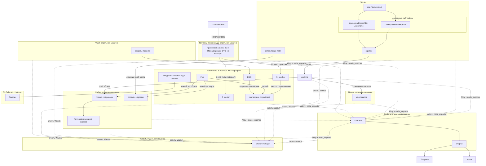

## Как устроено

## Описание процесса

На схеме два сюжета. Первый — что видит пользователь: браузер открывает сайт, запрос приходит на HAProxy и только оттуда попадает в приложение в Kubernetes. Второй — как туда попадает новая версия: разработчик пушит код, его проверяют, собирают образ, кладут в реестр, и кластер сам подтягивает релиз.

Вокруг этого стоят отдельные машины: кэш пакетов, хранилище секретов, мониторинг, безопасность и бэкапы. Они не обслуживают клик пользователя напрямую, но без них контур не считают готовым.

### 1. Точка входа — HAProxy

Пользователь не ходит на мастеры и воркеры Kubernetes напрямую. Единственная внешняя дверь — отдельная машина с HAProxy.

Запрос по HTTP или HTTPS (порты 80 и 443) HAProxy отправляет на воркеры. Там крутится приложение в namespace `project-test`. Административный доступ к API кластера идёт отдельно: порт 6443 HAProxy отдаёт на три master-узла. Так снаружи виден один адрес, а внутри нагрузка и управление кластером разведены.

### 2. Проверки в GitLab до пайплайна

Чтобы пользователь вообще увидел новую версию, разработчик сначала пушит код сервиса в GitLab. Pipeline (автоматическая цепочка шагов в Git) не стартует сразу. Сначала два контроля:

- сканирование репозитория на секреты — пароли, ключи и токены не должны оказаться в истории Git;
- проверка `Dockerfile` и `Jenkinsfile` — рецепт образа и сценарий сборки должны быть корректными.

Если любая проверка падает, сборка не начинается. Описание того, как приложение ставится в кластер (Helm-чарт), лежит в отдельном репозитории helm и через эти проверки кода сервиса не проходит.

### 3. Сборка в Jenkins

Когда проверки прошли, GitLab запускает Jenkins. Jenkins — сервер сборок: он забирает конкретный коммит из Git и выполняет `Jenkinsfile`, который лежит в этом коммите. Как собирать сервис, записано в репозитории, а не вручную в интерфейсе Jenkins.

Пакеты и зависимости Jenkins качает не из интернета напрямую, а из Nexus на отдельной машине. Nexus здесь кэш: быстрее и предсказуемее, чем каждый раз ходить во внешние репозитории. Готовый контейнерный образ Jenkins отправляет в Harbor. Чарт из helm-репозитория тоже собирается и публикуется в Harbor, но уже в проект с чартами.

### 4. Образы и чарты в Harbor

Harbor — внутренний реестр. В одном проекте лежат образы приложения, в другом — Helm-чарты. Кластер потом берёт артефакты отсюда, а не из Docker Hub.

Каждый новый образ автоматически сканирует Trivy. Это проверка уязвимостей в пакетах и базовом слое. Результат виден в Harbor до того, как образ окажется в Kubernetes.

### 5. Доставка в кластер через Flux

Кластер состоит из трёх master-узлов (управляют состоянием) и пяти и больше worker-узлов (на них работают контейнеры). Ставить релизы руками не нужно: этим занимается Flux.

Flux смотрит в Harbor, видит новый тег образа или чарта и сам применяет его в namespace `project-test`. Namespace — изолированный «кабинет» приложения внутри кластера: свои поды, сервисы и секреты.

Пароли и ключи приложения в Git не кладут. Они хранятся в Vault на отдельной машине. External Secrets Operator (ESO) забирает нужные значения из Vault и создаёт из них Kubernetes Secret в том же namespace, куда деплоится сервис. Приложение читает секреты уже внутри кластера.

### 6. Бэкапы

Раз в сутки снимаются база данных и статические файлы приложения. Копии уезжают во внешнее объектное хранилище S3 (Selectel или Hetzner), чтобы их можно было восстановить, даже если кластер недоступен.

### 7. Метрики и алерты

На отдельной машине стоит Grafana — дашборды и правила алертов. На каждом своём хосте (GitLab, Jenkins, Nexus, Harbor, HAProxy, узлы Kubernetes, Vault, Wazuh) работают Alloy и node_exporter: они снимают загрузку CPU, память, диск, доступность и отправляют это в Grafana.

Если узел пропал, диск кончился или сервис не отвечает, Grafana шлёт сообщение в Telegram или на почту.

### 8. Безопасность хостов — Wazuh

Wazuh тоже стоит на отдельной машине. На всех хостах контура, включая Grafana, установлен агент. Агенты присылают на manager системные логи, входы в систему, изменения важных файлов и признаки, что хост могли взломать.
